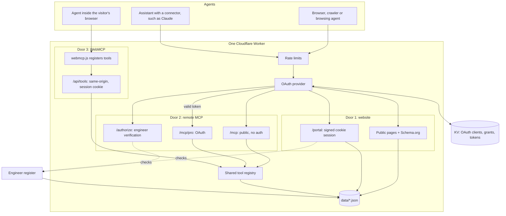

# Norvane Heating: gated content for AI agents

A reference demo by [Fold Digital](https://www.folddigital.com).

> **Fictional demo data. Not for real gas work.** Norvane Heating is not a real company, and the
> "Norvane Registered Engineer" scheme and its numbers are made up.

## What it shows, and why

Brands in regulated sectors hold two kinds of content: material anyone may read, and material
meant only for verified professionals. AI agents now reach that content in three different ways,
and each needs the gate to work.

This demo serves one set of content through all three, from a single Cloudflare Worker:

1. **A website**, with public pages and a signed-in engineer portal.
2. **A remote MCP server**, with a public endpoint and an OAuth-protected endpoint.
3. **WebMCP**, where the website itself hands tools to an agent in the visitor's browser.

The same question gets a homeowner answer or an engineer answer, depending on which door the
agent comes through and whether it has passed the gate.

A boiler manufacturer stands in for a regulated brand because the structure is the same:

| Pharma                         | Norvane demo                      |
| ------------------------------ | --------------------------------- |
| Patient information leaflet    | Homeowner user guide              |
| Prescribing information        | Installation and servicing manual |
| Field safety notices           | Technical bulletins               |
| Professional verification      | Registered engineer number check  |

## Architecture



How the gate works at each door:

| Door      | Public side                           | Gated side                                   | The gate                                                                 |
| --------- | ------------------------------------- | -------------------------------------------- | ------------------------------------------------------------------------ |
| Website   | Crawlable pages                       | `/portal/*`, `noindex`                       | Registration number + surname, then an HMAC-signed session cookie        |
| MCP       | `/mcp`, 7 homeowner tools             | `/mcp/pro`, those 7 plus 5 engineer tools    | OAuth 2.1. The `/authorize` page is the verification screen              |
| WebMCP    | 7 homeowner tools on every page       | 5 engineer tools after portal sign-in        | The portal session cookie on same-origin fetches. No OAuth at all        |

Points worth noticing in the code:

- **One source of truth.** `data/*.json` feeds the pages, both MCP endpoints and WebMCP.
- **One tool registry.** `src/tools.ts` defines each tool once (description, input schema, output
  schema, handler). `src/mcp.ts` registers them with the MCP SDK; `/api/tools` serves the same
  definitions to the browser script.
- **No third-party identity provider.** `src/authorize.ts` checks the register and calls
  `completeAuthorization` with props `{ regNumber, name }`. If the visitor already has a portal
  session, it offers a one-click "Continue as …" instead.
- **Stateless MCP.** `createMcpHandler` from `agents/mcp/server` over Streamable HTTP. No Durable
  Objects and no sessions.
- **Every tool is read-only**, marked `readOnlyHint: true`, and has an output schema.
- **Rate limits** on both MCP endpoints, the WebMCP tool API and the OAuth endpoints, using the
  Workers Rate Limiting binding (approximate). Both sign-in forms use an exact counter in a small
  Durable Object: five attempts a minute per IP address.

### Tools

Public (`/mcp`, and WebMCP on every page): `search_boilers`, `get_boiler`, `compare_boilers`,
`get_user_guide`, `lookup_fault_code_homeowner`, `find_installer`, `get_warranty`.

Engineer (`/mcp/pro`, and WebMCP after portal sign-in): `diagnose_fault_code`,
`get_installation_spec`, `get_parts`, `get_service_checklist`, `list_technical_bulletins`.

## Test credentials

These are fictional and are published on purpose. Use them on the portal sign-in page and on the
connector verification page.

| Registration number | Surname  | Result                 |
| ------------------- | -------- | ---------------------- |
| `NV-204817`         | Okafor   | Active: access granted |
| `NV-318642`         | Hartley  | Active: access granted |
| `NV-185309`         | Whitlock | Lapsed: refused        |
| `NV-296754`         | Devlin   | Suspended: refused     |

## Demo script

1. **Claude.ai with the public connector.** Add `https://<your-worker>/mcp` as a custom connector
   and ask: "My Norvane C30 shows F28. What does it mean and how do I fix the gas valve?"
   You get the homeowner answer and a pointer to engineers.
2. **Add the pro connector.** Add `https://<your-worker>/mcp/pro`. The verification page opens.
   Enter the test credentials, then ask the same question. You get the full engineer diagnostic,
   with readings and part numbers.
3. **Chrome with WebMCP.** Switch on `chrome://flags/#enable-webmcp-testing` and open the site.
   The badge shows the public tools. Sign in to the portal and the engineer tools appear. Ask the
   browser agent the same question.

The `/demo` page on the site lays the three doors out side by side for presentations.

## Run it locally

Needs Node 22 or later.

```bash
npm install
```

```bash
cp .dev.vars.example .dev.vars
```

```bash
npm run dev
```

The site is at `http://localhost:8787`. Wrangler simulates KV and the rate limiters locally, so no
Cloudflare account is needed.

Check the public MCP endpoint with the MCP Inspector:

```bash
npx @modelcontextprotocol/inspector --cli http://localhost:8787/mcp --transport http --method tools/list
```

For the OAuth flow, run `npx @modelcontextprotocol/inspector`, choose Streamable HTTP, and connect
to `http://localhost:8787/mcp/pro`.

## Deploy

```bash
npx wrangler login
```

```bash
npm run deploy
```

The first deploy creates the `OAUTH_KV` namespace for you and prints the Worker's URL.

```bash
npx wrangler secret put COOKIE_SECRET
```

Use a long random value, for example the output of `openssl rand -base64 48`. Portal sign-in
returns an error until this secret is set.

The Worker works out its public origin from each request, so there is no URL to configure. OAuth
tokens are bound to that origin plus `/mcp/pro`.

Configuration:

| Name              | Kind   | Purpose                                                                  |
| ----------------- | ------ | ------------------------------------------------------------------------ |
| `COOKIE_SECRET`   | Secret | Signs the portal session cookie. Lives in Cloudflare, never in the repo  |
| `PUBLIC_URL`      | Var    | Optional. Forces a canonical origin; empty means use the request origin  |
| `WEBMCP_OT_TOKEN` | Var    | Chrome origin trial token for WebMCP. Adds the `origin-trial` meta tag   |
| `OAUTH_KV`        | KV     | OAuth clients, grants and tokens (stored hashed and encrypted)           |

The `routes` in `wrangler.jsonc` attach `norvane-heating.com` and `www.norvane-heating.com` as
custom domains; the Worker redirects `www` to the apex. Change or remove them to deploy elsewhere.
Browser-based MCP clients hosted on other sites also need `allowedOriginHostnames` set on the two
`createMcpHandler` calls in `src/mcp.ts`.

## Project layout

```
data/               The content: boilers, guides, faults, parts, checklists, manuals,
                    bulletins, installers, engineers, warranty
public/webmcp.js    WebMCP registration and the badge
src/index.ts        OAuth provider and rate limits around everything
src/site.ts         Router: website, public /mcp, /api/tools, /authorize
src/tools.ts        The shared tool registry
src/mcp.ts          The two MCP servers
src/authorize.ts    Engineer verification screen for OAuth
src/auth.ts         Signed cookie sessions
src/limits.ts       Rate limiting and the sign-in attempt counter
src/pages-*.ts      Server-rendered pages
src/html.ts         Layout, styles and HTML helpers
```

## Licence

MIT. See [LICENSE](LICENSE).
